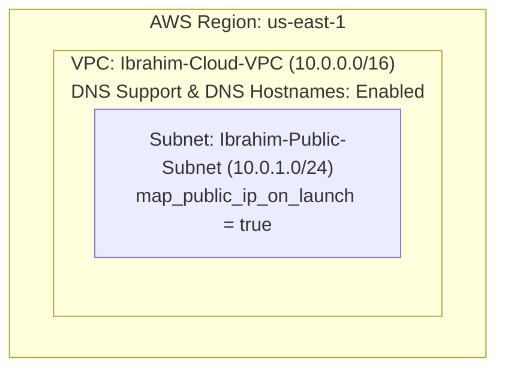

<div align="center">

# AWS Infrastructure Provisioning with Terraform (VPC & Subnet)


**Automated provisioning of a custom AWS VPC (`10.0.0.0/16`) and public subnet (`10.0.1.0/24`) using Terraform Infrastructure as Code.**

</div>

---

## 1. Architecture Overview



> [!IMPORTANT]
> **Key Design Decision:** Defining the VPC and subnet declaratively in `main.tf` ensures repeatable, version-controlled networking with DNS resolution and automatic public IPv4 assignment enabled from the start, avoiding manual AWS Console drift.

---

## 2. Problem & Solution

| Aspect | Detail |
| :--- | :--- |
| **Problem** | Manual VPC and subnet setup in the AWS Console is repetitive, error-prone, and difficult to reproduce consistently across environments. |
| **Solution** | Provisioned `Ibrahim-Cloud-VPC` (`10.0.0.0/16`) and `Ibrahim-Public-Subnet` (`10.0.1.0/24`) declaratively in Terraform (`main.tf`). |
| **Configuration Boundary** | Scoped to `us-east-1` with `enable_dns_hostnames = true`, `enable_dns_support = true`, and `map_public_ip_on_launch = true` (no Internet Gateway or EC2 instances deployed yet, keeping cost at `$0`). |

---

## 3. Tech Stack
- **Cloud:** Amazon Web Services (AWS VPC, Subnet — `us-east-1`)
- **Infrastructure as Code:** Terraform (`v1.17.1+`, `hashicorp/aws` provider)
- **CLI & Environment:** Ubuntu on WSL2, AWS CLI (`v2.x`), Git & GitHub

---

## 4. Implementation Steps (Summary)
1. Configured the `aws` provider for region `us-east-1` in `main.tf`.
2. Defined `aws_vpc.my_first_vpc` (`Ibrahim-Cloud-VPC`) with CIDR `10.0.0.0/16`, `enable_dns_hostnames = true`, and `enable_dns_support = true`.
3. Defined `aws_subnet.public_subnet` (`Ibrahim-Public-Subnet`) inside the VPC with CIDR `10.0.1.0/24` and `map_public_ip_on_launch = true`.
4. Initialized, validated, and applied the Terraform configuration, then cleaned up resources when done to keep AWS spend at `$0`.

<details>
<summary><b>Click to expand Terraform run commands & resource summary</b></summary>

```bash
# 1. Clone the repository
git clone https://github.com/ibrahim-a-elsayed-eng/terraform-aws-vpc.git
cd terraform-aws-vpc

# 2. Initialize providers and validate syntax
terraform init
terraform validate

# 3. Preview and apply the infrastructure
terraform plan
terraform apply

# 4. Destroy lab resources after testing
terraform destroy
```

**Resources defined in `main.tf`:**
- `aws_vpc.my_first_vpc` → `10.0.0.0/16` (`Name = "Ibrahim-Cloud-VPC"`)
- `aws_subnet.public_subnet` → `10.0.1.0/24` (`Name = "Ibrahim-Public-Subnet"`)

</details>

---

## 5. Verification & Results
- **IaC Structure Verified:** `main.tf` defines both `aws_vpc.my_first_vpc` and `aws_subnet.public_subnet` with `.terraform.lock.hcl` locking the provider dependency.
- **Validation Workflow:** `terraform validate` and `terraform plan` confirm syntax and resource graph (`public_subnet` references `aws_vpc.my_first_vpc.id`) before provisioning.

---

## 6. Key Engineering Takeaways
- **Reproducibility:** Terraform removes manual Console clicks and makes VPC CIDR, DNS flags, and subnet attributes explicit in code.
- **Cost & Lifecycle Control:** VPC and Subnet resources incur `$0` cost, and `terraform destroy` cleanly tears down the lab when finished.
